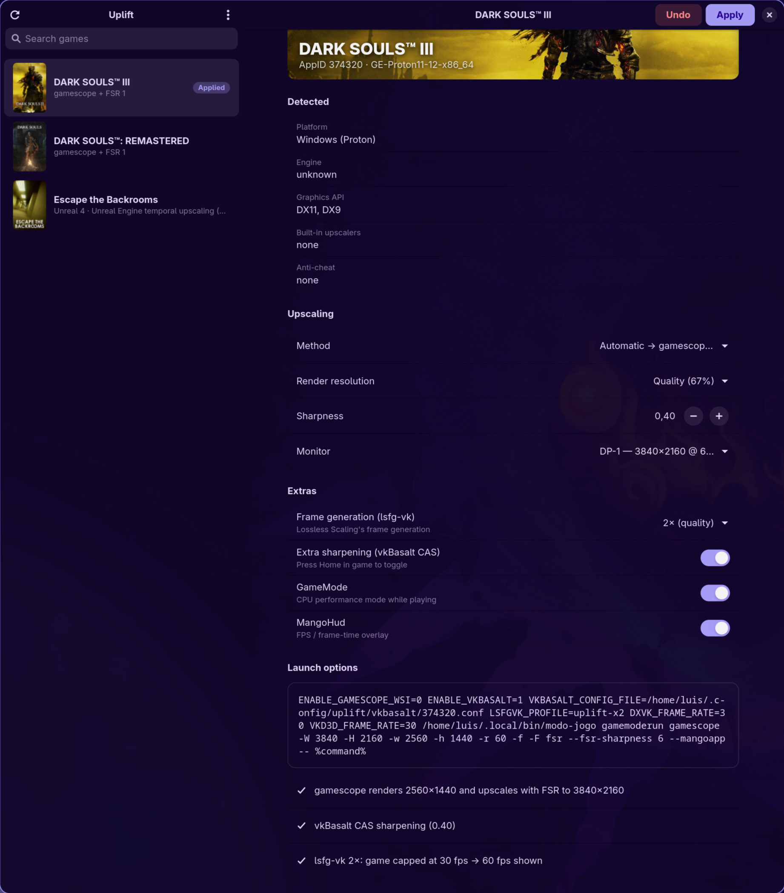

# Uplift

**Better upscaling and frame generation for your Steam games on Linux — picked per game, applied in one click, undone in one click.**

[Português](README.pt-BR.md)



Uplift reads your Steam library, inspects every installed game (engine, graphics API, bundled upscalers, anti-cheat) and sets up the best upscaling path that game supports:

| The game has… | Uplift does | Quality |
|---|---|---|
| DLSS, XeSS or FSR 2/3 | Installs **[OptiScaler](https://github.com/optiscaler/OptiScaler)** and swaps it for **FSR 3.1** (works on any GPU) | Real temporal upscaling |
| Unreal Engine 4/5, no upscaler in the menu | Enables the engine's own **TAAU (UE4) / TSR (UE5)** via `Engine.ini` | Temporal — close to FSR 2 |
| Nothing | **gamescope + FSR 1 or NIS** at the resolution you pick, with tuned sharpness | Spatial |
| Any of the above | Optional **vkBasalt CAS** sharpening, **lsfg-vk** frame generation (Lossless Scaling), GameMode, MangoHud | |

It also writes the Steam **launch options** for you: Steam keeps them in a file it rewrites while running, so Uplift closes Steam, saves them and reopens it. Your own launch options are kept (env vars, wrappers, game arguments) and common mistakes are fixed (`%%command`, `gamemode` instead of `gamemoderun`).

Everything is recorded and **reversible**: files Uplift adds are removed, files it replaces are backed up, `Engine.ini` keys get their previous values back, and the launch options return to exactly what they were.

## Install

```bash
git clone https://github.com/ludoviciphilip/uplift
cd uplift && ./install.sh
```

Needs Python 3.10+.

`./install.sh` offers to install the tools Uplift drives (gamescope, MangoHud, GameMode, vkBasalt, lsfg-vk, GTK/Textual) with your distro's package manager — Arch (+AUR via paru/yay), Debian/Ubuntu, Fedora, openSUSE. `--deps` installs without asking, `--no-deps` skips. **Lossless Scaling** (needed by lsfg-vk) is a paid Steam app: install it and pick the `lsfg-vk` beta branch.

## Use

- `uplift` — window: pick a game, adjust, **Apply** / **Undo**
- `uplift --tui` — the same in the terminal (`a` apply, `u` undo, `/` search)
- Command line, for scripts:

```bash
uplift list                                   # library + recommendation per game
uplift show "escape the backrooms"            # detection + plan
uplift plan 374320 --method gamescope-fsr --quality quality --lsfg x2-perf   # dry run
uplift apply 374320 --lsfg x2-perf -y         # apply (restarts Steam if it's open)
uplift undo 374320 -y
uplift doctor                                 # tools, monitors, GPU
```

## Notes

- **OptiScaler path is experimental**: tested end-to-end on a synthetic library (install → re-apply → byte-identical undo), not yet on many real DLSS/FSR2 games. Reports welcome!
- **Anti-cheat** (EasyAntiCheat, BattlEye…): Uplift never drops DLLs into those games.
- **OptiScaler on NVIDIA GTX** with DLSS-only games is experimental (GPU spoofing + fakenvapi). Games with FSR 2/XeSS inputs work without it.
- **Unreal**: run the game once so it creates its config folder.
- **lsfg-vk**: Uplift caps the game at refresh ÷ multiplier (`DXVK_FRAME_RATE`/`VKD3D_FRAME_RATE`) so generated frames land on the display's refresh.
- Uplift doesn't redistribute OptiScaler; it downloads the official release from GitHub.

## Tests

```bash
python3 -m unittest discover -s tests -v
```

Builds a fake Steam library (Unreal game, DLSS+FSR2 game, DX11 game, anti-cheat game), applies, re-applies and undoes, and checks every file is byte-identical afterwards.

## License

MIT
