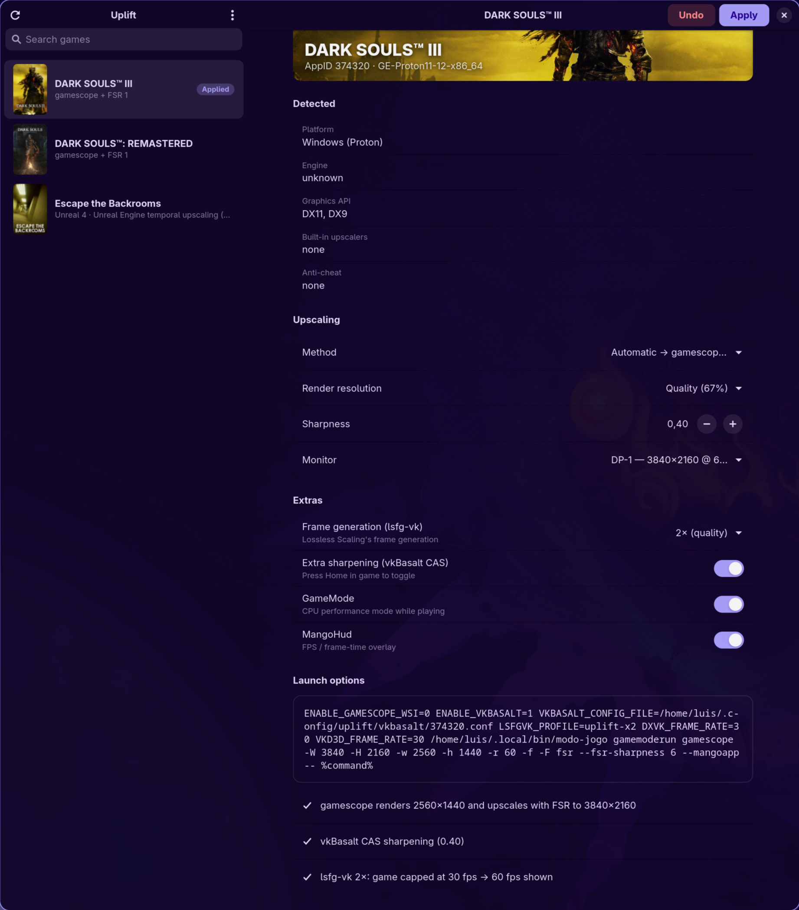

# Uplift

**Upscaling e geração de quadros melhores para os seus jogos da Steam no Linux: escolhido por jogo, aplicado e desfeito com um clique.**

[English](README.md)



O Uplift lê sua biblioteca da Steam, examina cada jogo instalado (motor, API gráfica, upscalers que o jogo já traz, anticheat) e configura o melhor caminho de upscaling que aquele jogo suporta:

| O jogo tem… | O Uplift faz | Qualidade |
|---|---|---|
| DLSS, XeSS ou FSR 2/3 | Instala o **[OptiScaler](https://github.com/optiscaler/OptiScaler)** e troca por **FSR 3.1** (funciona em qualquer placa) | Upscaling temporal de verdade |
| Unreal Engine 4/5 sem upscaler no menu | Liga o **TAAU (UE4) / TSR (UE5)** do próprio motor pelo `Engine.ini` | Temporal, perto do FSR 2 |
| Nada | **gamescope + FSR 1 ou NIS** na resolução que você escolher, com a nitidez ajustada | Espacial |
| Qualquer um acima | Opcionais: nitidez **CAS do vkBasalt**, geração de quadros **lsfg-vk** (Lossless Scaling), GameMode, MangoHud | |

Ele também grava as **opções de inicialização** da Steam. Como a Steam reescreve esse arquivo enquanto está aberta, o Uplift fecha a Steam, grava e abre de novo. As suas opções são mantidas (variáveis, wrappers, argumentos do jogo), e erros comuns são corrigidos (`%%command`, `gamemode` no lugar de `gamemoderun`).

Tudo é registrado e **reversível**: arquivos adicionados são removidos, arquivos substituídos têm backup, as chaves do `Engine.ini` voltam ao valor anterior e as opções de inicialização voltam a ser exatamente o que eram.

## Instalação

```bash
git clone https://github.com/ludoviciphilip/uplift
cd uplift && ./install.sh
```

Precisa de Python 3.10+.

O `./install.sh` oferece instalar as ferramentas que o Uplift usa (gamescope, MangoHud, GameMode, vkBasalt, lsfg-vk, GTK/Textual) com o gerenciador de pacotes da sua distro: Arch (+AUR via paru/yay), Debian/Ubuntu, Fedora, openSUSE. `--deps` instala sem perguntar, `--no-deps` pula. O **Lossless Scaling** (exigido pelo lsfg-vk) é pago na Steam: instale e escolha o beta `lsfg-vk`.

## Uso

- `uplift`: janela. Escolha o jogo, ajuste, **Aplicar** / **Desfazer**
- `uplift --tui`: o mesmo no terminal (`a` aplica, `u` desfaz, `/` busca)
- Linha de comando, para scripts:

```bash
uplift list                                   # biblioteca + recomendação por jogo
uplift show "escape the backrooms"            # detecção + plano
uplift plan 374320 --method gamescope-fsr --quality quality --lsfg x2-perf   # simulação
uplift apply 374320 --lsfg x2-perf -y         # aplica (reinicia a Steam se estiver aberta)
uplift undo 374320 -y
uplift doctor                                 # ferramentas, monitores, placa de vídeo
```

## Observações

- **O caminho do OptiScaler é experimental**: testado de ponta a ponta numa biblioteca sintética (instalar → reaplicar → desfazer idêntico byte a byte), ainda não em muitos jogos reais com DLSS/FSR2. Relatos são bem-vindos!
- **Anticheat** (EasyAntiCheat, BattlEye…): o Uplift nunca coloca DLLs nesses jogos.
- **OptiScaler em NVIDIA GTX** com jogos que só têm DLSS é experimental (spoof de GPU + fakenvapi). Jogos com FSR 2/XeSS funcionam sem isso.
- **Unreal**: abra o jogo uma vez para ele criar a pasta de configuração.
- **lsfg-vk**: o Uplift trava o jogo em taxa do monitor ÷ multiplicador (`DXVK_FRAME_RATE`/`VKD3D_FRAME_RATE`), para os quadros gerados caírem no ritmo da tela.
- O Uplift não redistribui o OptiScaler: baixa a versão oficial do GitHub.

## Licença

MIT
